# Dadanada Platform,

**Architecture guide for business stakeholders**

| | |
|---|---|
| Prepared for | Client presentation |
| Version | 1.0 |
| Date | October 2026 |
| Scope | Platform architecture, service plans, industry solutions |

---

## Contents

2. [The four layers](#2-the-four-layers)
3. [From sign-up to a working system](#3-from-sign-up-to-a-working-system)
4. [The three service plans](#4-the-three-service-plans)
5. [The 24 industry solutions](#5-the-24-industry-solutions)
6. [Industry solutions in detail](#6-industry-solutions-in-detail)
10. [Where we are and what comes next](#10-where-we-are-and-what-comes-next)
11. [Glossary](#11-glossary)
12. [Technical appendix](#12-technical-appendix)

---

## 2. The four layers

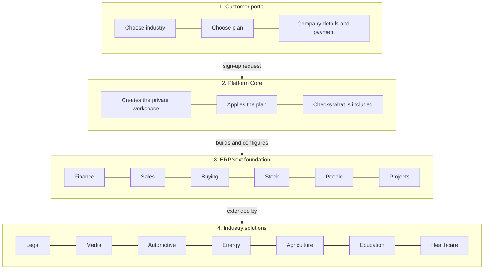

| Layer | What it does | Who it is for |
|---|---|---|
| **1. Customer portal** | Industry selection, plan comparison, company details, payment and sign-up | The customer |
| **2. Platform Core** | Creates the customer's workspace, records what they bought, applies the plan, controls access to features | The service provider |
| **3. ERPNext foundation** | The standard business engine: accounts, sales, purchasing, stock, assets, people, projects | Every customer, at the level they bought |
| **4. Industry solutions** | Ready-made records and workflows for a specific trade | The customer's operational staff |

A useful way to think about the boundary: the foundation knows how to **record a sale**, **hold stock** or **run payroll**. The industry solution knows what a **matter**, a **licence window**, a **job card**, a **meter reading** or a **bed allocation** is, and how it turns into that sale, stock movement or payroll entry.

---

## 3. From sign-up to a working system

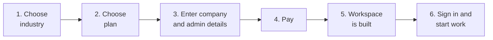

| Step | What the customer does | What Dadanada does behind the scenes |
|---|---|---|
| 1 | Picks their trade from the 24 industry solutions | Loads the matching industry template and its starter data |
| 2 | Picks a plan: Essential, Growth or Enterprise | Records the plan and the features that come with it |
| 3 | Enters company name, currency, country and the first administrator | Creates the private site, company, chart of accounts and admin user |
| 4 | Pays by card or invoice | Confirms the subscription and triggers provisioning |
| 5 | Waits a few minutes | Builds the site, installs the modules, applies the industry pack and starter fixtures |
| 6 | Signs in | Lands on a workspace already laid out for their trade |

Two practical points:

- **Safe to retry.** A sign-up step can fail because of a dropped connection. Repeating it does not create a second company or a duplicate site. The platform recognises the original request and finishes it.
- **No consulting project.** The initial workspace is ready in minutes. Configuration of the customer's own chart of accounts and opening balances is the main remaining task, and that is a guided exercise, not a build.

---

## 4. The three service plans

The plans are cumulative. Growth includes everything in Essential; Enterprise includes everything in Growth.

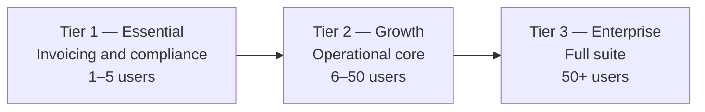

### 4.1 Who each plan suits

| | **Tier 1 — Essential** | **Tier 2 — Growth** | **Tier 3 — Enterprise** |
|---|---|---|---|
| **Typical customer** | A small firm that mainly needs to invoice, collect and stay compliant | A growing business that also holds stock, buys from suppliers and employs staff | A larger or multi-entity group that needs projects, manufacturing, treasury and group reporting |
| **Users** | 1–5 | 6–50 | 50+ |
| **Companies** | 1 | Up to 3 | Unlimited, with group consolidation |
| **Currencies** | One base currency | Multi-currency and inter-company | Global multi-currency and consolidation |
| **Environments** | Production only | Production plus staging | Production, staging and disaster recovery |
| **Support** | Business hours, next-business-day response | Extended hours, 8-hour response | 24×7, 4-hour response, named account manager |
| **Data warehouse** | Not included; in-app reports only | Optional add-on | Included |
| **Payment and compliance** | Point of sale and fiscal e-invoice | Adds stock, buying, CRM, HR and payroll flags | Adds full accounting, manufacturing, projects, quality, treasury, revenue recognition, FinTech engines and BI |

### 4.2 What is included in each plan

#### Tier 1 — Essential: invoicing and compliance

| Module | What the business gets | Reports and documents |
|---|---|---|
| **Accounts** | The books: chart of accounts, journal entries, payments, tax and bank reconciliation | Sales register, tax summary, receivables ageing, daily cash position |
| **Selling** | Quotations, sales orders, invoices, credit notes and customer records | Item-wise sales |
| **Regional** | Country-specific tax and statutory setup | Correct local tax treatment |
| **Utilities** | Data import, backup, email and system settings | Day-to-day administration |
| **Communication** | Email, SMS and in-app notifications | Reminders and alerts |
| **Portal** | Self-service for customers and suppliers | Customers view and print their own documents |
| **Setup** | Company, users, roles and permissions | Controlled access |
| **ERPNext Integrations** | Connectors to external services | e-invoicing, payments and similar |

Also included: point of sale (POS) and fiscal e-invoice with QR. Standard print formats: fiscal invoice with QR, receipt, credit note and quotation.

#### Tier 2 — Growth: the operational core

Tier 2 adds the day-to-day operating modules on top of Tier 1.

| Module | What the business gets | Reports and documents |
|---|---|---|
| **Stock** | Warehouses, items, stock movements and valuation | Stock ledger and balance, stock ageing, valuation summary |
| **Buying** | Suppliers, purchase orders, receipts and purchase invoices | Purchase analytics, supplier performance |
| **CRM** | Leads, opportunities, contacts and pipeline | Pipeline conversion |
| **Assets** | Asset register, depreciation and maintenance schedules | Asset lifecycle |
| **Support** | Helpdesk tickets and service levels | Service performance |
| **Maintenance** | Preventive and corrective maintenance | Equipment upkeep |
| **Bulk Transaction** | Bulk create and submit documents | Faster month-end |
| **EDI** | Electronic data interchange with trading partners | Partner documents |
| **Telephony** | Click-to-call and call logging | Sales and service follow-up |
| **Website** | Public website and enquiry forms | Online presence |
| **Payments** | Payment gateway integration | Online collection |
| **HR** | Employees, leave, attendance and appraisals | Attendance summary |
| **Payroll** | Salary structures, payroll runs and payslips | Payroll register |

Standard print formats add delivery note, packing slip, purchase order, supplier quotation and purchase receipt.

#### Tier 3 — Enterprise: the full suite

Tier 3 adds the modules needed by larger and multi-entity organisations.

| Module | What the business gets | Reports and documents |
|---|---|---|
| **Projects** | Projects, tasks, timesheets and project costing | Profitability by project and dimension |
| **Manufacturing** | Bills of material, work orders, production planning and job cards | Production and capacity, WIP valuation, cost variance |
| **Quality Management** | Inspections, non-conformance and quality goals | Quality certificate |
| **Treasury** | Cash and bank positions, investments and loans | Treasury and cash flow |
| **Subcontracting** | Outsourced operations and material tracking | Subcontract cost control |
| **eCommerce** | Online store and fulfilment | Omnichannel sales |
| **Full accounting** | Statutory financial statements, consolidation and revenue recognition | Trial balance, profit and loss, balance sheet, statutory format, consolidated group reporting |
| **FinTech engines** | Wallets, float, settlement, fees, disputes and ISO 20022 (for payment businesses) | PAR and ECL, settlement sheet |
| **Data warehouse and BI** | Management reporting across the group | Warehouse data mart |

Tier 3 also includes manufacturing job cards and settlement sheets as standard print formats.

### 4.3 How the plan is enforced

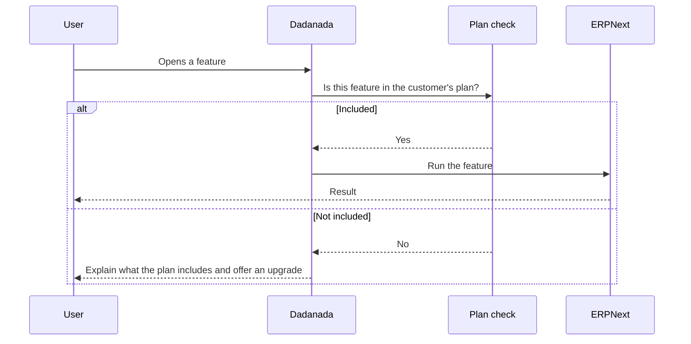

The important business consequence: **data is never trapped by a plan**. A customer on Essential can keep trading; when they upgrade, the higher-tier modules appear on the same workspace with the same company, customers and history. There is no second implementation.

The platform checks the plan at the point where a feature is requested, not only in the menu. Hiding a menu item is not treated as security.

---

## 5. The 24 industry solutions

Each industry template is a published, versioned manifest. It names the ERPNext modules the trade needs, the industry records that are added, the automation that should run, the acceptance tests and the starter data.

### 5.1 Status at a glance

| Status | Meaning |
|---|---|
| **Available today** | Deep build in the product: records, screens, workspace and core automation verified |
| **Available on standard app** | Delivered through a mature Education or Healthcare application plus the industry-pack extension |
| **Template ready** | Manifest published; the configuration is assembled with the customer |

### 5.2 The catalogue

| Code | Industry | Built on these ERPNext modules | Status |
|---|---|---|---|
| IND-18 | Legal practices | Accounts, Selling, Projects, HR | **Available today** |
| IND-16 | Media and entertainment | Accounts, Selling, Projects, Payroll | **Available today** |
| IND-15 | Automotive dealerships and garages | Accounts, Selling, Stock, Buying | **Available today** |
| IND-17 | Renewable energy and independent power | Accounts, Selling, Projects, Maintenance | **Available today** |
| IND-14 | Agriculture and smart farming | Accounts, Selling, Stock, Buying | **Available today** |
| IND-02 | Healthcare and hospitals | Accounts, Selling, Stock, HR, Buying | **Available on standard app** |
| IND-13 | Education and school management | Accounts, Selling, HR, Payroll | **Available on standard app** |
| IND-01 | FinTech and payment service providers | Accounts, Selling, CRM, Support, Projects, Payments | Template ready |
| IND-03 | Pharmaceuticals and pharmacies | Accounts, Selling, Stock, Buying | Template ready |
| IND-04 | Restaurants and food service | Accounts, Selling, Stock, Buying, POS, eCommerce | Template ready |
| IND-05 | Hotels and property management | Accounts, Selling, CRM, Maintenance, Payroll | Template ready |
| IND-06 | Construction and infrastructure | Accounts, Projects, Stock, Buying, HR, Subcontracting | Template ready |
| IND-07 | Retail, e-commerce and supermarkets | Accounts, Selling, Stock, Buying, eCommerce, POS, Payments | Template ready |
| IND-08 | Manufacturing, discrete and process | Accounts, Selling, Stock, Buying, Manufacturing, Quality, Subcontracting | Template ready |
| IND-09 | Logistics, supply chain and fleet | Accounts, Selling, Stock, Buying, Projects, Fleet Management | Template ready |
| IND-10 | Professional services and IT consulting | Accounts, Selling, Projects, HR, Payroll | Template ready |
| IND-11 | Real estate agencies and brokerage | Accounts, Selling, CRM, Projects | Template ready |
| IND-12 | Wholesale and B2B distribution | Accounts, Selling, Stock, Buying, CRM | Template ready |
| IND-19 | Subscription SaaS businesses | Accounts, Selling, CRM, Support, eCommerce | Template ready |
| IND-20 | Mining and raw extraction | Accounts, Selling, Stock, Buying, Projects, Energy | Template ready |
| IND-21 | Microfinance institutions | Accounts, Selling, CRM, Loans, Payments | Template ready |
| IND-22 | Banks and deposit-taking institutions | Accounts, CRM, Treasury, Payments | Template ready |
| IND-23 | Bookshops and publishing retail | Accounts, Selling, Stock, Buying | Template ready |
| IND-24 | Beauty and wellness outlets | Accounts, Selling, Stock, POS, CRM | Template ready |

The next section describes the seven solutions that are built or delivered through a standard application. The remaining seventeen use the same foundation and the same onboarding path; their industry records are configured from the published templates.

---

## 6. Industry solutions in detail

Every solution below has the same shape: a **hub record** that everything hangs from, a small set of **supporting records**, and **automation** that turns ordinary work into the right financial result.

### 6.1 Legal practices

For law firms and in-house legal teams. The matter is the centre of everything: time, costs, billing, client money and deadlines all belong to a matter.

**Built on:** Accounts, Selling, Projects, HR.

**Typical flow**

Client intake → conflict check → open matter → record time and disbursements → pre-bill review → invoice → settle from trust or office account → review matter profitability.

**Main records**

| Record | What it is for | Key fields | What the system is designed to do |
|---|---|---|---|
| **Matter** | The engagement hub | matter_no, client, matter_type, practice_area, responsible_partner, status, limitation_date, fee_arrangement, fee_cap, engagement_letter | Connects client, team, court and fee terms; feeds billing and profitability |
| **Matter Party** | Everyone connected to the matter | party_type, party_name, role, is_adverse, related_entity | Supplies the conflict search and ethical-wall checks |
| **Conflict Check**, **Conflict Party Check**, **Conflict Search Result** | Pre-engagement screening | prospective_client, parties_checked, risk_level, clearance_status, cleared_by, conditions; match_type, matched_matter, similarity | Searches existing clients, matters and parties; records the decision and conditions |
| **Time Entry Extension** | Billable and non-billable time | matter, fee_earner, work_date, activity_type, task_code, narrative, duration_hours, hourly_rate, billable, write_down_pct | Resolves the agreed rate; supports write-downs with a reason |
| **Disbursement** | Costs paid for the client | matter, type, amount, paid_from, recoverable, markup_pct, vat_treatment, receipt, sales_invoice | Separates office-paid from trust-paid costs; recharges at cost or with an agreed markup |
| **Matter Billing Run** | The pre-bill and invoice run | period_from, period_to, fee_arrangement, time_entries, disbursement_lines, total_write_down, cap_applied, contingency_amount, vat, withholding_tax, retainer_applied | Handles hourly, fixed, capped and contingency fees; applies retainers; produces the invoice |
| **Retainer** | Money received in advance | retainer_type, amount, paid_into, balance, evergreen_floor, status | Tracks drawdown and top-up obligations |
| **Trust Account** | The client-money bank account | company, bank_account, currency, law_society_registration, signatories, reconciliation_frequency, is_default | Keeps client money separate from office money |
| **Trust Ledger Entry** | One movement per client or matter | trust_account, matter, client, entry_type, debit, credit, running_balance, reference, reconciled | Maintains a per-client running balance and prevents a client going negative |
| **Trust Reconciliation**, **Trust Unreconciled Item** | The monthly three-way check | bank_statement_closing_balance, trust_ledger_control_balance, sum_of_client_ledgers, differences, partner_signoff; date, reference, amount, reason | Proves the bank, the control account and the client ledgers agree; records outstanding items |
| **Docket Event**, **Reminder Rule** | Court dates and deadlines | matter, event_type, event_date, court_forum, responsible_fee_earner, reminder_rules, status, next_event, escalation_level | Escalates approaching deadlines to the responsible person |
| **Fee Rate Card** | Agreed pricing | client, practice_area, fee_earner, role_level, hourly_rate, overtime_rate, effective_from, effective_to | Chooses the right rate for the work and the person |
| **Court Forum**, **Matter Type**, **Practice Area** | Reference data | court name, jurisdiction, level; matter type; practice area and default rate card | Keeps setup consistent across the firm |

**Build status:** records, screens and workspace are complete. The automation that joins them into a fully hands-off billing and trust cycle is the current build item; the document describes the intended end state.

### 6.2 Media and entertainment

For broadcasters, studios, publishers and advertising sales houses. The same platform handles two revenue streams: selling advertising and licensing content.

**Built on:** Accounts, Selling, Projects, Payroll.

**Typical flow**

Acquire or create content → record rights and licence windows → sell advertising or license the content → schedule and deliver → calculate royalties → recognise revenue and amortise the content cost.

**Main records**

| Record | What it is for | Key fields | What the system does |
|---|---|---|---|
| **Content Asset** | The content catalogue, held as a tree: franchise → series → episode | title, series, parent_asset, asset_type, genre, language, duration_minutes, production_year, isan, eidr, isrc, rights_ownership, status | Builds the hierarchy, creates a billing item and tracks net book value |
| **Content Deliverable**, **Content Genre** | Versions and classification | deliverable_type, language_dub, subtitle_language, territory, format, delivery_status; genre_name | Keeps delivery and catalogue metadata together |
| **Rights Agreement**, **Rights Agreement Line** | Who granted which rights | direction, counterparty, start_date, end_date, territory, media, exclusivity, royalty_contract; content_asset, fee_type, fee_amount | Records acquired and sold rights |
| **Licence Window** | One right, territory and period | content_asset, rights_agreement, start_date, end_date, territory, media, language, exclusivity, licence_fee, recognition_method | Drives availability and deferred revenue |
| **Licence Fee Schedule** | When licence money falls due | milestone, due_date, amount, recognition_trigger, sales_invoice | Matches fees to delivery milestones |
| **Deferred Revenue Schedule**, **Deferred Revenue Line** | Revenue spread across the licence | licence_window, total_fee, recognition_method, start_date, end_date; period, recognised, deferred_balance | Recognises revenue month by month |
| **Amortisation Schedule**, **Amortisation Line** | Content cost written off over its life | content_asset, total_cost, method, start_date, end_date, ultimate_revenue; period, amortisation_amount, accumulated, closing_nbv | Produces the amortisation journal |
| **Royalty Contract**, **Royalty Contract Asset**, **Royalty Tier**, **Royalty Deduction** | What a rights holder earns | rights_holder, calculation_basis, rate_pct, rate_per_unit, advance_amount, recoupment_rules; content_asset, rate_override; from_amount, to_amount, rate_pct | Calculates royalties, recoups advances and allows deductions |
| **Royalty Run**, **Royalty Run Line** | The periodic royalty calculation | period_from, period_to, gross_revenue, deductions, net_revenue, rate_applied, royalty_earned, advance_recouped, net_payable | Calculates the run and posts the accrual |
| **Royalty Statement** | The statement sent to the rights holder | royalty_run, rights_holder, period, gross, net, withholding_tax, net_payable, purchase_invoice | Creates the payable and the purchase invoice |
| **Media Channel**, **Daypart**, **Rate Card** | Advertising inventory and price | channel, daypart, start_time, end_time, spot_duration_sec, rate_per_spot, agency_commission_pct, validity | Prices advertising spots |
| **Media Plan**, **Media Plan Line** | The campaign plan and budget | advertiser, agency, campaign_name, dates, budget; channel, daypart, spots, rate | Allocates budget by channel and daypart |
| **Insertion Order**, **Spot Schedule** | The advertising contract and the spots | io_no, media_plan, advertiser, agency, channel, dates, total_spots, gross_value, commission, net_billable; scheduled date/time, status, actual air time | Creates the sales order and the spot schedule |
| **Make-Good** | Remedy when a spot is pre-empted | insertion_order, reason, resolution, original_spot, make_good_spot, credit_amount | Issues the credit note |
| **Production Budget**, **Production Budget Line** | What a production should cost | content_asset, budget_version, cost_head, budgeted_amount | Tracks budget against actual |

**Build status:** complete and in use, including revenue recognition, royalties, advertising orders and the content tree.

### 6.3 Automotive dealerships and repair garages

For dealerships, service centres and independent garages. One vehicle record follows the car through sales, service, warranty and trade-in.

**Built on:** Accounts, Selling, Stock, Buying.

**Typical flow**

Vehicle arrives → intake and condition record → job card with complaints and inspection → estimate approval → parts issued and labour logged → quality check → invoice → warranty claim or trade-in.

**Main records**

| Record | What it is for | Key fields | What the system does |
|---|---|---|---|
| **Vehicle Make**, **Vehicle Model**, **Vehicle Record**, **Vehicle Configuration**, **Vehicle Specification**, **Vehicle Option**, **Vehicle Ownership** | The vehicle and its history | vin, license_plate, make, model, year, engine_no, chassis_no, customer, serial_no, warranty_expiry, current_odometer | One vehicle record used by sales, service and warranty |
| **Service Workshop**, **Bay**, **Bay Schedule** | Capacity and scheduling | workshop_name, parts_warehouse, wip_warehouse, cost_center; bay_name, bay_type, capacity_hours_per_day; scheduled_start, scheduled_end, status | Prevents double-booking and shows utilisation |
| **Vehicle Intake** | Check-in at the workshop | odometer_in, fuel_level, promised_time, service_advisor, customer_complaint, visible_condition, belongings | Starts the job and records the vehicle's condition |
| **Service Job Card** | The repair order | vehicle_record, vehicle_intake, service_workshop, bay, repair_type, status, customer, total_estimate, actual_labour_cost | Calculates the estimate, issues parts, creates the invoice and updates actual cost |
| **Job Complaint**, **Inspection Finding**, **Inspection Result** | What the customer reported and what was found | complaint, severity, recommended_action; checklist_item, result, measured_value | Builds the diagnosis and the recommended work |
| **Job Estimate** | A versioned quotation | estimate_version, line_type, description, item, qty, rate, approval_status | Requires approval before work starts or parts are issued |
| **Job Labour Line**, **Job Part Line**, **Job Sublet** | The billable work | service_item, hours, rate; item, qty, rate, warehouse, batch_no, serial_no; vendor_cost, markup_pct, charge_amount | Prices labour, issues stock and applies sublet markup |
| **Job Technician**, **Technician Time Log** | Who did the work and for how long | employee, technician_role, planned_hours; start_time, end_time, duration_hours, is_billable, hour_rate | Captures actual labour cost and productivity |
| **Trade-In Appraisal**, **Appraisal Checklist** | Valuing a used vehicle | prospective_vehicle, condition_checklist, estimated_market_value, reconditioning_estimate, offer_amount | Creates the trade-in item and stock entry |
| **Warranty Claim**, **Warranty Settlement** | Recovering defects from the manufacturer | claim_type, claimed_amount, responsible_party, fault_description, part_disposition, status; approved_amount, settlement_type | Tracks the claim through to the credit note or journal |

**Build status:** complete, including parts issue, labour, invoicing, warranty and trade-in.

### 6.4 Renewable energy and independent power

For solar, wind and hydro producers. The plant, the power purchase agreement and the meter readings are the three anchors; billing follows from them.

**Built on:** Accounts, Selling, Projects, Maintenance.

**Typical flow**

Commission the plant → sign the power purchase agreement and tariff → read the meters → capture generation → run billing (energy, capacity, deemed generation and curtailment) → invoice the offtaker → reconcile generation, billed and paid.

**Main records**

| Record | What it is for | Key fields | What the system does |
|---|---|---|---|
| **Power Plant** | The generating asset | plant_name, location, capacity_mwp, capacity_mwac, commercial_operation_date, grid_connection_point, cost_center, warehouse, project, ppa_contract | The hub for meters, generation and billing |
| **Component Asset** | Inverters, transformers and other components | asset, plant, parent_asset, component_type, serial_no, capacity_kw, warranty_expiry, criticality, condition_score | Asset register and maintenance planning |
| **PPA Contract** | The power purchase agreement | offtaker, plant, contract_date, effective_date, term_years, expiry_date, contracted_capacity, tariff_schedule, take_or_pay, minimum_energy_guarantee, availability_guarantee_pct | Sets billing rules, guarantees and expiry |
| **Tariff Schedule**, **Tariff TOU Line**, **Tariff Seasonal Line** | How energy is priced | energy_rate_per_kwh, capacity_rate_per_kw_month, escalation, tou periods, seasons, reactive_power_rate, minimum_monthly_bill | Chooses the right rate for each period |
| **Meter**, **Meter Reading** | The measured output | meter_serial, meter_type, ct_ratio, voltage_ratio, multiplier, accuracy_class, calibration_due; opening and closing kWh, net_export, import, max_demand, power_factor | Converts raw readings with multipliers and validates them against generation |
| **Generation Log** | Plant production | gross_generation, net_export, auxiliary_consumption, irradiance, temperatures, availability, curtailment, grid_outage, soiling_loss, inverter_efficiency | Supports performance and loss analysis |
| **PPA Billing Run** | The monthly invoice calculation | period, energy_delivered, energy_rate, energy_charge, capacity_charge, availability_achieved, deemed_generation, curtailment_compensation, shortfall_penalty, liquidated_damages, reactive_power_charge | Calculates the bill, creates the sales invoice and locks the meter readings |
| **Billing Adjustment** | One-off additions or deductions | description, amount, account | Adjusts the bill |
| **Curtailment Grid Outage Log** | Lost generation events | event_type, start_datetime, end_datetime, instructed_by, lost_generation_kwh, compensable | Supports compensation claims |
| **Performance Ratio Snapshot** | Plant efficiency | actual_generation, poa_irradiance, specific_yield, expected_generation, performance_ratio, availability_factor, losses | Monthly performance reporting |
| **Covenant Report** | Lender and contract commitments | covenant_type, threshold, actual_value, compliance_status, cure_period_end | Tracks compliance and cure periods |
| **Revenue Assurance Reconciliation** | Generation versus billed versus paid | generation_log_kwh, meter_reading_kwh, billed_kwh, paid_kwh, unexplained_kwh, unbilled_revenue | Finds revenue leakage |

**Build status:** complete, including meter validation, PPA billing to sales invoice, and revenue assurance.

### 6.5 Agriculture and smart farming

For farms and agribusiness. The field block and the crop cycle are the centres; costs are collected there and carried into each harvested lot.

**Built on:** Accounts, Selling, Stock, Buying.

**Typical flow**

Define the farm and its blocks → plant a crop cycle → issue seed, fertiliser and chemicals → record labour and machinery → harvest → weighbridge → allocate cost per kilogram → sell the produce.

**Main records**

| Record | What it is for | Key fields | What the system does |
|---|---|---|---|
| **Farm**, **Field Block** | Land and its subdivisions | farm_name, farm_type, total_area_ha, default_warehouse, cost_center; block_name, parent_block, area_ha, soil_type, geo_json, warehouse | The land hierarchy and the cost centre for each farm |
| **Crop**, **Crop Variety**, **Crop Cycle** | What is grown and the season | crop_name, expected_yield_per_ha, growth_duration; planting_date, expected_harvest_date, status, project, cost_center, expected_yield_kg, actual_yield_kg, total_cost, cost_per_kg | Opens a project and cost centre, rolls up costs and blocks invalid dates |
| **Input Application** | Seed, fertiliser and chemicals issued to a cycle | crop_cycle, field_block, application_date, warehouse, item, qty, rate, rate_per_ha, batch, total_cost, stock_entry | Issues stock and books the cost to the cycle |
| **Farm Activity** | Labour, machinery and other work | activity_type, crop_cycle, date, labour_hours, labour_rate, labour_cost, machinery_hours, machinery_rate, machinery_cost, expense_account | Captures labour and machinery cost |
| **Harvest Lot** | A harvested batch | crop_cycle, field_block, harvest_date, grade, qr_code, gross_weight_kg, moisture_pct, net_weight_kg, batch, stock_entry, allocated_cost, cost_per_kg | Creates the batch and stock entry and carries the cost |
| **Weighbridge Ticket** | Independent weight capture | ticket_number, vehicle, timestamp, crop_cycle, grade, moisture, gross_weight, tare_weight, net_weight, harvest_lot | Matches physical intake and is safe to re-import |
| **Yield Cost Distribution**, **Yield Cost Distribution Item** | Allocating cost across lots | allocation_method, total_cost_to_allocate; harvest_lot, weight_kg, market_value, ratio, allocated_cost, cost_per_kg | Distributes cost by weight or market value |
| **Livestock**, **Animal Species** | Animals and their valuation | livestock_id, species, field_block, status, initial_value, valuation_method, current_value | Tracks herd value |
| **Quality Grade**, **Soil Texture**, **Telemetry Reading** | Reference and sensor data | moisture_max_pct; water_holding_capacity; device_id, reading_type, value, timestamp | Supports grading and precision farming |

**Build status:** complete, including stock issue, harvest batches, weighbridge matching, cost allocation and crop-cycle project costing.

### 6.6 Education and school management

For schools, colleges and training providers. The student is the centre; enrolment connects teaching to billing.

**Built on:** Accounts, Selling, HR, Payroll, plus the standard Education application.

**Typical flow**

Admit the student → enrol in a programme and courses → set the fee structure → raise term fees → collect and allocate payments → track attendance and results → run staff payroll.

**Delivery:** the standard Education application provides the academic record (111 record types). The industry pack adds fee payment allocation so that money received is matched to the right term and invoice.

**Main records**

| Record | What it is for | Key fields | What the system does |
|---|---|---|---|
| **Student** | The learner's master record | first_name, last_name, date_of_birth, gender, student_email_id, student_mobile_number, joining_date, student_applicant, guardians | One record across admissions, fees and results |
| **Student Applicant**, **Admission Register** | Admissions pipeline | applicant details, programme, status | Converts applicants into students |
| **Program**, **Course**, **Academic Year**, **Academic Term** | What is taught and when | program_name, department, program_level; course; year and term dates | The academic catalogue and calendar |
| **Course Enrollment** | A student's enrolment | admission_register, student, course, program, academic_term, fee_term, fee_plan, billing_status, status | Links the student to teaching and billing |
| **Fee Structure**, **Fee Term**, **Fee Schedule** | What to charge and when | program, student_category, academic_term, academic_year, components, total_amount; term dates, invoice_cycles | Generates term fee invoices |
| **Fees** | The student invoice | student, fee_schedule, posting_date, due_date, program, course_enrollment, fee_structure, components, grand_total | Posts the receivable to the ledger |
| **Payment Record** | A payment received | student, payment_id, status, amount, currency, against_invoice | Captures the money |
| **Fee Payment Allocation**, **Fee Payment Allocation Line** | Matching money to fees | student, payment_record, fee_structure, allocation_date, amount_received, allocations, unallocated_balance, status; fee_term, amount_allocated | Allocates the oldest term first and leaves any excess unallocated |
| **Student Attendance** | Daily or period attendance | student, date, status, student_batch, leave_application | Attendance registers and reports |
| **Assessment Plan**, **Assessment Result** | Exams, marks and grades | course, academic_term, assessment_group; student, score, maximum_score, percentage | Produces results and report cards |
| **Guardian**, **Instructor** | Parents and teaching staff | guardian_name, contact, students; instructor_name, employee, department | Contact and payroll links |
| **Hostel**, **Room**, **Hostel Allocation** | Boarding | hostel, room, bed, allocation dates | Boarding billing and occupancy |

**Automation in the pack:** term fee run from the fee structure; automatic late-fee penalty; arrears by class; payments allocated to terms in order.

**Acceptance tests:** the fee run matches the structure to the cent; arrears reconcile to the ledger; payments are allocated in order.

### 6.7 Healthcare and hospitals

For hospitals, clinics and diagnostic centres. The patient is the centre; the admission and the insurance claim are the two financial paths.

**Built on:** Accounts, Selling, Stock, HR, Buying, plus the standard Healthcare application.

**Typical flow**

Register the patient → book an appointment or consultation → order tests and prescriptions → admit (allocate a bed) → charge bed-days nightly → perform procedures → discharge → submit the insurance claim → record the remittance.

**Delivery:** the standard Healthcare application provides the clinical record (126 record types). The industry pack adds bed-day charging, theatre kits and the insurance claim lifecycle.

**Main records**

| Record | What it is for | Key fields | What the system does |
|---|---|---|---|
| **Patient** | The clinical master record | patient_name, sex, blood_group, dob, mobile, email, customer, allergies, medication, medical_history | One record across visits, billing and claims |
| **Patient Appointment**, **Healthcare Practitioner** | Scheduling and clinicians | patient, practitioner, service_unit, appointment_date, appointment_time, status, invoiced; practitioner name, department, consulting charges | Books and tracks consultations |
| **Clinical Note**, **Diagnosis**, **Drug Prescription**, **Lab Test**, **Observation** | The clinical record | patient, practitioner, note, posting_date; drug, dosage, period; test, sample, result; observation, result | Documents the encounter and orders |
| **Healthcare Service Unit** | Wards, beds, theatres and clinics, held as a tree | service_unit_name, parent, is_group, service_unit_type, inpatient_occupancy, warehouse | The location hierarchy and capacity |
| **Inpatient Record** | An admission | patient, primary_practitioner, status, admitted_datetime, expected_length_of_stay, expected_discharge, admission_encounter, discharge_encounter | The admission hub |
| **Bed Allocation** | Which bed, for how long | healthcare_service_unit, patient, inpatient_record, admission_date, expected_discharge, actual_discharge, bed_daily_rate, rate_source, status | Assigns the bed and the daily rate |
| **Bed Day Charge Run**, **Bed Day Charge Line** | Nightly bed charges | charge_date, company, nights_charged, beds_charged, gross_amount, insurance_share, patient_share, charge_lines | Generates nightly charges and splits insurer from patient |
| **OT Kit**, **OT Booking**, **OT Booking Kit** | Theatre scheduling and consumables | kit_name, default_item, sterilisation_required; patient, practitioner, procedure_type, start_datetime, end_datetime, kits, pre_op_notes, post_op_notes | Books theatre time and tracks kit usage |
| **Insurance Payor** | The insurer | insurance_payor_name, customer, claims_receivable_accounts, rejected_claims_expense_accounts, insurance_claim_credit_days | Defines the payer and its accounts |
| **Pre-Authorisation** | Approval before treatment | patient, insurance_payor, policy_number, request_type, requested_amount, approved_amount, valid_until, status, denial_reason | Records the approval and its validity |
| **Insurance Claim**, **Claim Line**, **Claim Remittance** | The claim lifecycle | payor, patient, dates, insurance_claim_amount, approved_amount, rejected_amount, paid_amount, outstanding; service_code, units, rate, line_status, denial_code; remittance_reference, approved, paid, patient_responsibility, write_off, rejection_reason_code | Tracks submission, rejection, approval, payment and write-off |
| **Clinical Encounter Note**, **Discharge Summary** | The clinical close-out | patient, inpatient_record, chief_complaint, diagnosis, treatment_done, advice_on_discharge, followup_date | Records the encounter and closes the episode |

**Automation in the pack:** nightly bed-day charging; claim rejection reason coding; pill count versus dispensed reconciliation; a gate that prevents un-billed dispensing.

**Acceptance tests:** a full patient journey with one reconciled bill; bed-day charges generated nightly; rejection codes reportable; no dispensed drug left un-billed.

---

## 10. Where we are and what comes next

| Stage | Scope | State |
|---|---|---|
| **Now** | Legal, Media, Automotive, Renewable Energy, Agriculture | Records, screens, workspaces and core automation built and verified. Legal's billing and trust automation is the remaining build item |
| **Now** | Education, Healthcare | Delivered on the standard Education and Healthcare applications, with the industry-pack extensions for fee allocation, bed-day charging and claims |
| **Next** | FinTech and Banking, Manufacturing, Retail and Wholesale | Templates published; configuration and acceptance work follows the same pattern as the built verticals |
| **Later** | The remaining industry templates | Same foundation, same onboarding, same plan model |

The rollout order follows commercial demand, not technical difficulty. Every vertical uses the same four layers, so adding one does not change the architecture.

---

## 11. Glossary

| Term | Plain meaning |
|---|---|
| **Tenant** | A customer's private workspace and database |
| **Site** | The running copy of the software that serves one tenant |
| **Module** | A functional area such as accounts, stock, HR or projects |
| **DocType** | A type of business record — the equivalent of a form or a table (for example, Matter or Meter Reading) |
| **Plan / tier** | The service level a customer buys: Essential, Growth or Enterprise |
| **Entitlement** | The recorded right to use a module or feature, based on the plan |
| **Industry template / pack** | The published setup for a trade: which modules, which extra records, which automation and which starter data |
| **Posting** | Recording money in the books |
| **Posting matrix** | The rule book that maps each business event to the accounts to debit and credit |
| **Journal entry** | A balanced debit-and-credit record in the ledger |
| **Chart of accounts** | The list of accounts a business uses |
| **Idempotent** | Safe to repeat: the same request run twice does not create a duplicate |
| **Trust accounting** | Holding client money separately and proving it is all there |
| **Workspace** | The home screen a user sees, with shortcuts and cards for their work |

---

## 12. Technical appendix

This section is for the implementation team. It records the source of truth, the record inventory and the relationships between records.

### 12.1 Source of truth

| Subject | Where it is defined |
|---|---|
| Plan contents and service levels | `tier_builds/tier_1.json`, `tier_builds/tier_2.json`, `tier_builds/tier_3.json` |
| Plan reports and print formats | `tier_builds/report_catalog.md`, `tier_builds/print_catalog.md` |
| Industry manifests | `industry_packs/packs/ind-01.json` … `ind-24.json` and `catalog.json` |
| Industry application logic | `industry_packs/generator.py`, `services/industry_service.py` |
| Tenant, entitlement and provisioning | `platform_core/platform/doctype/`, `platform_core/services/` |
| Posting rules | `fixtures/posting_matrix/`, `services/posting_service.py` |
| Chart of accounts | `fixtures/coa/` |

The plan files are applied by `services/tier_service.py`. Applying a plan is idempotent: running it twice produces the same result.

### 12.2 Record inventory

| Area | Record types | Notes |
|---|---|---|
| Platform Core | 16 | Tenant, entitlement, template, provisioning log, quota, posting matrix, closed period, exception queue, idempotency, API credential, settings |
| Legal | 25 | Matter-centric; trust records included |
| Media | 30 | Content tree, rights, royalties, advertising, revenue recognition |
| Automotive | 26 | Vehicle, workshop, job card, warranty, trade-in |
| Renewable energy | 16 | Plant, PPA, tariff, meter, generation, billing, assurance |
| Agriculture | 16 | Farm, field, crop cycle, inputs, harvest, weighbridge, costing |
| Education | 111 standard + 2 pack | Standard Education application plus fee payment allocation |
| Healthcare | 126 standard + 10 pack | Standard Healthcare application plus bed-day and claims extensions |

### 12.3 Data model conventions

- **Master records** hold reference data (vehicles, meters, crops, payors).
- **Submittable records** represent a commitment and are locked after submission (billing runs, claims, royalty runs, harvest lots, job cards).
- **Child tables** hold the lines of a parent record (time lines, tariff periods, charge lines, claim lines).
- **Tree records** hold hierarchies (content assets, farms and blocks, service units, trust accounts).
- Every record carries standard creation, modification and ownership fields for audit.

### 12.4 Relationships

#### Legal

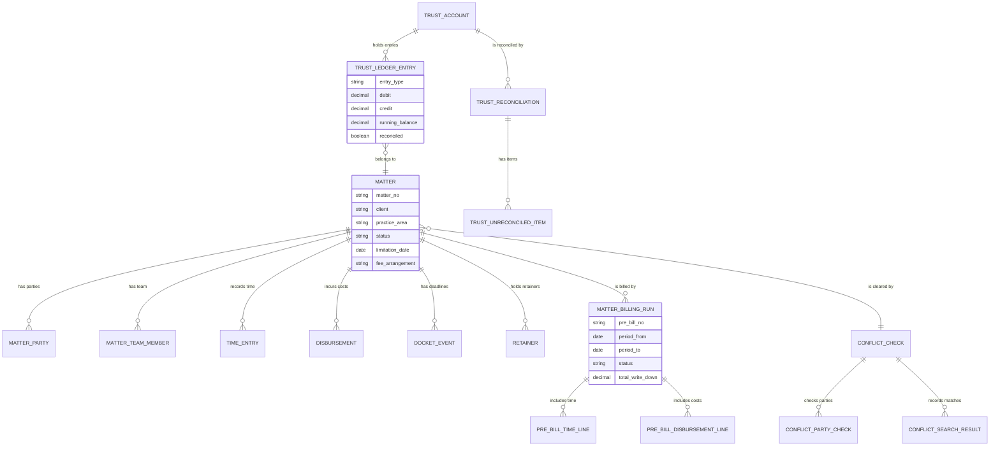

#### Media

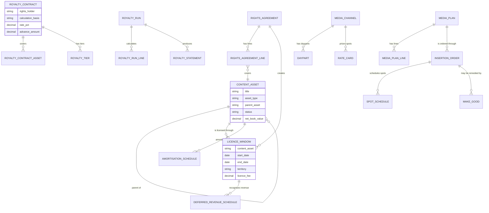

#### Automotive

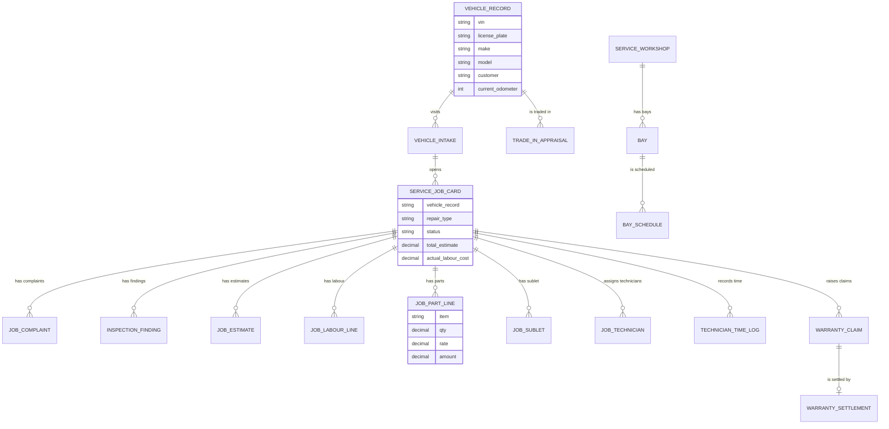

#### Renewable energy

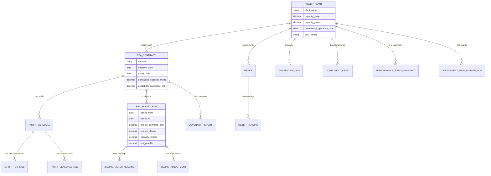

#### Agriculture

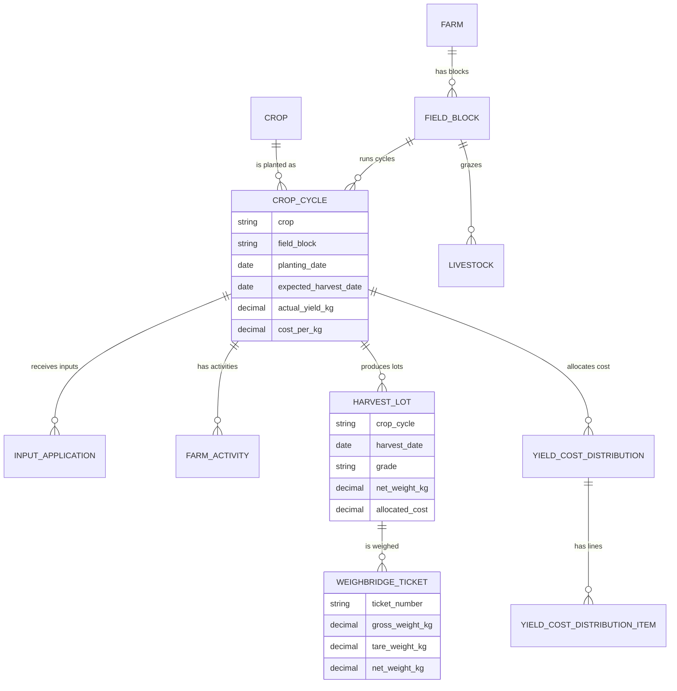

#### Education

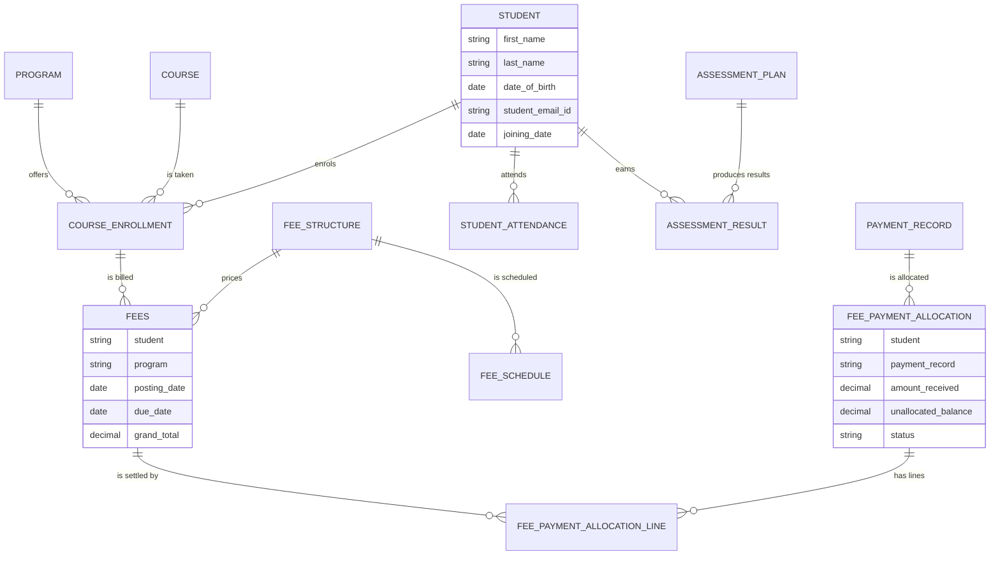

#### Healthcare

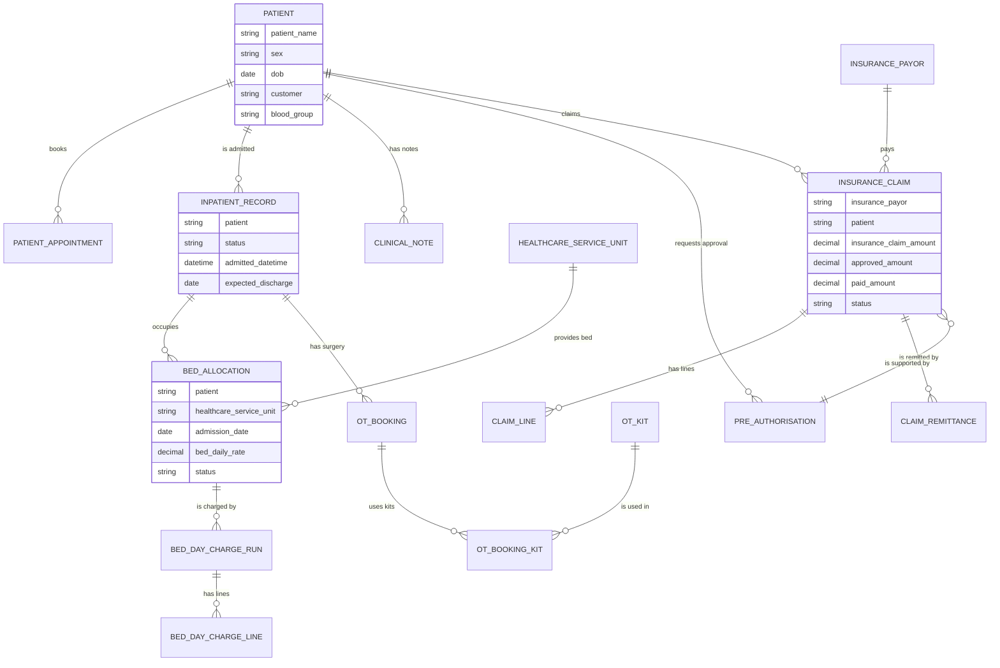

### 12.5 Build status by vertical

| Vertical | Records | Screens | Workspace | Controllers | JavaScript |
|---|---|---|---|---|---|
| Legal | 25 | Yes | Yes | In progress | Partial |
| Media | 30 | Yes | Yes | Yes | Yes |
| Automotive | 26 | Yes | Yes | Yes | Yes |
| Renewable energy | 16 | Yes | Yes | Yes | Yes |
| Agriculture | 16 | Yes | Yes | Yes | Yes |
| Education | Standard app plus 2 pack records | Standard app | Standard app | Standard app | Standard app |
| Healthcare | Standard app plus 10 pack records | Standard app | Standard app | Standard app | Standard app |

"Controllers" means the Python logic that enforces rules and creates the downstream financial documents. Legal's records and screens are in place; its controllers are the current build item.

---

*End of document.*
